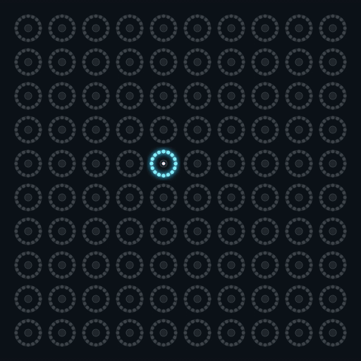

# SpringTable

SpringTable is an interactive light installation made from metal doorstop springs and LED rings. Brush the springs to hear them twang and send ripples across the board. In the interference patterns, two plucks leave bright bands where crests meet and dark gaps where opposing waves cancel.

**[Play SpringTable Studio in your browser](https://biogoly.github.io/SpringTable/)**

[](https://biogoly.github.io/SpringTable/)

## Try it in Studio

Move the pointer across the virtual springs, tap them on a touchscreen, or focus the board and use the arrow keys and Enter. To try two springs with one mouse, choose **Reflected Interference** in the **Play** tab, click **Pick two springs**, then click two different rings. The second click launches both waves. Watch what happens when a returning wave crosses one still moving outward.

Studio includes twelve patterns. **Ricochet** sends a colored ball bouncing between the edges. **Drain** pulls a trail into a tightening spiral and ends in a white flash. In **Layout**, arrange up to 400 rings in a grid, hexagonal lattice, circle or spiral, or place them individually. **Pattern lab** lets you design your own touch waves and per-pixel effects. Save a layout and its patterns together as a JSON project.

For offline use, download the repository ZIP, extract it, and open `SpringTable Studio.html`. The Studio guide includes example projects, the pattern catalog and the controls for experimenting with wave colors. [Download ZIP](https://github.com/biogoly/SpringTable/archive/refs/heads/master.zip) · [Studio guide](docs/studio.md)

## Build a physical table

Each metal spring acts as a capacitive electrode. An MPR121 reports contact to a Teensy 4.1, which drives 16-pixel WS2812-compatible RGB rings. The firmware includes two grid configurations.

| Firmware profile | LED rings | Touch sensors |
| --- | --- | --- |
| Three-ring row (default) | 3 rings, 48 pixels | 1 MPR121, connected directly or through a TCA9548A multiplexer |
| 10 × 10 grid | 100 rings, 1,600 pixels | 10 MPR121s, one per row, on a TCA9548A multiplexer |

A single ripple can use its full brightness. When the estimated current for a frame exceeds the configured budget, the firmware dims all rings together. The hardware guide covers wiring, choosing a budget for the installation, calibrating touch sensitivity, and checking one row at a time. [Hardware guide](docs/hardware.md) · [Teensy sketch](SpringTable/SpringTable.ino)

Both profiles have compiled for Teensy 4.1 and the effects have been tested in simulation. Physical touch response and current draw still need bench verification. Custom Studio layouts and Pattern lab effects require a firmware change to run on a physical table.

## Development

Studio uses plain JavaScript. From the repository root, use Node.js 22 or later to rebuild the single-file app and run its tests.

```sh
node studio/build.cjs
node --test "tests/*.cjs"
```

The firmware's effect and current-limiter tests also run on a computer with a C++17 compiler. [Studio source](studio/) · [Firmware tests](tests/firmware/)

SpringTable draws on the light patterns of **ReactTable**, an earlier table that used infrared sensors. Its first seven effects adapt ideas from that project for capacitive touch. [Original ReactTable sketch](https://github.com/biogoly/ReactTable/blob/e1dc361c69e6003bb54fb86ba15025fc07abb1e3/ReactTable.ino)
