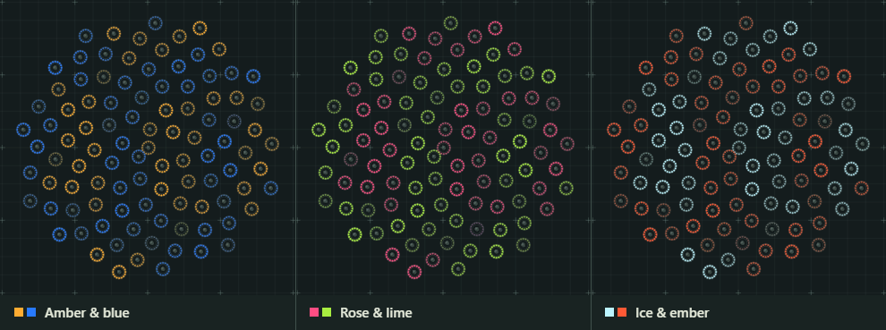
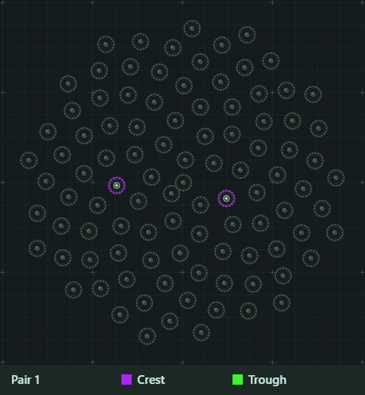
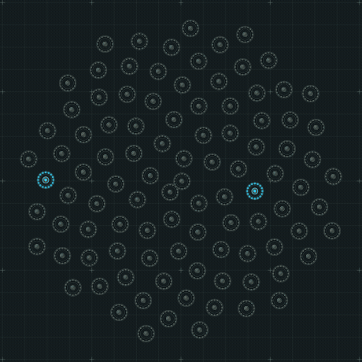
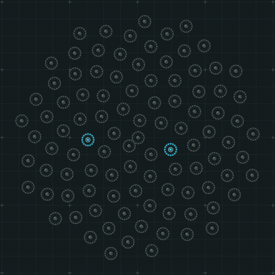
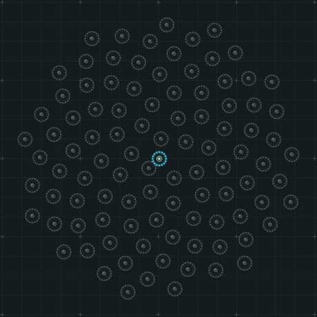
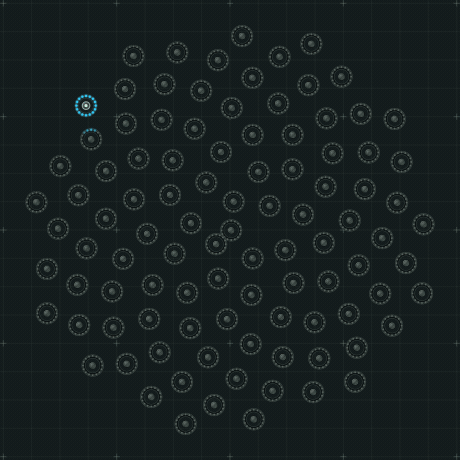
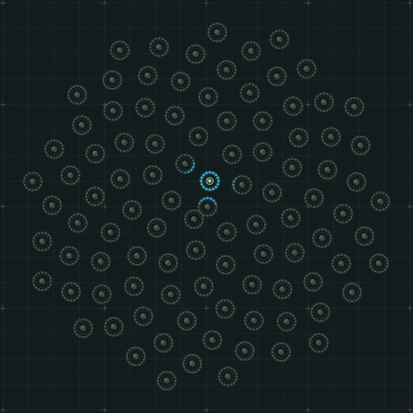

# SpringTable

A Teensy 4.1 sketch for playing a wall or tabletop of spring door stoppers. Brush the metal coil and its ring lights immediately. In the default ripple mode, light reaches the next ring about 100 ms later and a diagonal neighbor about 141 ms later. Two hands can start overlapping waves. Holding a spring leaves a dim center, and releasing and touching it again launches a fresh wave.

The supplied sketch starts with **three stoppers, three 16-pixel rings, one MPR121 and one TCA9548A**. The full profile is a proposed square grid of 100 stoppers and 1,600 RGB pixels. Power and touch sensitivity need checking on your actual rings and mounting board.

The animation below uses the sketch's ripple renderer with simulated touches. A bright dot in a spring's center marks finger contact. Brightness is scaled for the screen.


## Try the table on screen

**[Launch SpringTable Studio](https://biogoly.github.io/SpringTable/)** in your browser. On first launch it plays a demo sweep. Move the mouse across a ring to take over, or hold the mouse button on a spring for a sustained touch. Touchscreens support simultaneous fingers. With the canvas focused, use the arrow keys to select a spring and Enter to hold it.

For offline use, choose **Code → Download ZIP** on GitHub, extract it, and open `SpringTable Studio.html`. To build the physical table, open [`SpringTable/SpringTable.ino`](SpringTable/SpringTable.ino) in the Arduino IDE. The root `ReactTable.ino` is the original IR sketch.

- **Play** selects any of the twelve firmware effects. Click a ring and pick one of its 16 pixels in the inspector to see its transmitted RGB values. Pause and step in 16 ms increments to inspect motion. **Touch all** and the current budget control let you see whole-frame dimming and compare requested and sent current.
- **Layout** can generate a grid, hexagonal lattice, circle or spiral, up to 400 rings. Set the count or dimensions, change spacing in millimeters, drag individual rings, or use **Add ring** and click on the board. You can enter exact X/Y positions, remove rings and undo layout changes. **Fit** frames the board, and Space-drag or middle-drag pans. The default ring drawing is 38 mm in diameter, and the standard grid has 60 mm center spacing. For a bench comparison, set one row, three columns, 60 mm spacing and a 1.5 A budget.
- **Pattern lab** creates and edits named patterns. A **Touch wave** has adjustable color, speed, shape, reach, trail and held glow. **Pixel formulas** let you write red, green and blue expressions for each individual LED. For instance, set red to `if(held, 255 * (p == floor(t * 12) % 16), 0)`, green and blue to `0`, and apply it. Hold a spring to see a single red pixel orbit its ring. The lab lists the supported variables and functions. **Apply & test pattern** adds the pattern to the Play menu.
- **Save project** exports the positions, custom patterns, active effect and budget to JSON. **Open** restores them. Studio also tries to keep the last applied project in browser storage. Keep the JSON for sharing, moving between browsers or long-term storage.

### Choose wave colors

In **Interference** or **Reflected Interference**, open **Play → Wave palette**. Choose **Amber & blue**, **Rose & lime** or **Ice & ember**, or click the **Crest** and **Trough** swatches to set either color independently. Both modes share the selection. Colors update on the current frame, even when paused, so you can compare palettes on the same wave. A crest and an equal trough still cancel to black. The LED current estimate and limiter use the new RGB values.

**Save project** keeps your colors with the layout. Older projects open with the original **Aqua & violet** pair. Open [Amber and Blue Spiral.json](Amber%20and%20Blue%20Spiral.json) for a 100-ring example. The image below shows the same Reflected Interference frame in three palettes.



For the physical table, expand **Teensy command** under the swatches and enter that line in Serial Monitor. For example, `palette FFAC32 287AFF` sets amber crests and blue troughs for both modes. Send `palette` to see the current colors or `palette reset` to restore the configured defaults. Serial changes last until the Teensy restarts. To change the startup colors, edit `InterferenceCrestRGB` and `InterferenceTroughRGB` in `Config.h` and upload the sketch.

Studio and the C++ firmware matched all 3,005,952 output RGB bytes in 1,216 palette test frames. Those tests included recoloring active waves, changing the current limit and restoring the defaults. The colors shown on screen are simulations; the appearance of the physical rings still needs a bench check.

### Random colors for each pair

In either interference pattern choose **Wave palette → Random per pluck pair**. Click **Pick two springs** and choose two different rings. The second click launches both in a fresh crest and trough color. Pick another pair while those ripples are still traveling: the first pair keeps its colors, including its reflections. **Run demo** also draws a new palette for each pair. Open [Random Palette Spiral.json](Random%20Palette%20Spiral.json) in Studio to try it.

The swatches show the most recently launched pair. Click **Keep these colors** to use it as a fixed palette for both modes. You can also edit either swatch or choose a named preset. **Save project** remembers the Random selection and the displayed swatches. Reopening the project leaves the next draw ready for your first pluck.

With direct touches, the first spring starts a color group. Springs touched while another is held join that group. A brush across two different springs also shares a palette if the second press follows the first by less than 250 ms. Once both have been released, the next pair draws new colors. Re-plucking the same spring by itself starts a fresh group. The two-click picker always launches its two springs as one group, regardless of how long you take to choose them.

When different groups overlap, their signed wave heights still add first. Equal crests and troughs cancel to black. Where there is light, colors from the stronger side of the wave blend in proportion to their contributions. The current limiter uses the resulting RGB values just as it does in fixed mode.



On the Teensy, send `palette random` in Serial Monitor to enable random draws, or `palette fixed` to return to your last manual colors. Send `palette` to query the policy and latest colors. To start in random mode after every power cycle, set `InterferenceRandomPerPair` to `true` in `Config.h` and upload the sketch.

With matching test seeds, Studio and the C++ firmware agreed on the displayed colors, requested and sent current, and all 2,907,072 output RGB bytes over 1,176 frames. Those tests covered overlapping pairs, timing across clock rollover, manual overrides and current limiting.

### Reflected Interference

Choose **Play → Pattern → Reflected Interference**, or use Studio's **Open** button with [Reflected Interference Spiral.json](Reflected%20Interference%20Spiral.json). Click **Pick two springs**, then click two different rings. Both launch on the second click. Pluck near an edge and farther inside to see the first echo cross the other spring's outgoing ripples. **Run demo** repeats a synchronized pair.

Each pluck sends four cycles of ripples across the board at 600 mm/s. They reflect once from the outer edge and return at 1,500 mm/s with the same phase and strength. At each ring, the outgoing and returning waves from every pluck add together. The wave palette colors the result, equal opposite waves cancel to black, and the current budget applies to the final colors.

To see what the echoes contribute, use the **Aqua & violet** palette and a three-ring row with 60 mm spacing. Pause, pick the left and middle rings in that order, then press the right arrow to inspect the right ring without plucking it. After 17 steps (272 ms), a returning crest cancels an outgoing trough and the right ring is black. After 32 steps total (512 ms), the return reinforces the outgoing crest and the right ring shows RGB(29,154,187). Repeating the same plucks in ordinary **Interference** gives RGB(22,15,43) and RGB(22,115,140) at those times.

On the Teensy, send `mode 11` in Serial Monitor. The bench and full-table firmware matched Studio's current estimates and all 1,369,488 post-limit RGB bytes across 554 test frames for this effect.



### Interference

Select **Play → Pattern → Interference**, or open [Interference Spiral.json](Interference%20Spiral.json) from Studio. Click **Pick two springs**, then click two different rings. Both rings launch on the second click, at exactly the same simulation time. You can also use the arrow keys and Enter for each pick, or Esc to cancel. Touchscreen and physical-table users can pluck two springs directly. **Run demo** repeats a synchronized pair.

In the original palette, aqua shows a crest and violet a trough. Where two crests meet, the ring gets brighter. Where equal and opposite waves meet, the LED values are exactly zero. Plucks can also be staggered: changing their relative timing moves the bright and dark bands. Each packet travels at 600 mm/s with a 240 mm wavelength. A ring sees three full-strength cycles and one fading cycle as it passes. The renderer adds the signed wave heights before coloring the LEDs and applying the current budget.

For a repeatable three-ring test with **Aqua & violet**, use 60 mm center spacing and pick the left and right spring. At 400 ms both outer rings are black: each spring's own crest meets the other spring's trough. At 500 ms the middle ring receives two crests and shows RGB(38,198,240), double the single-crest RGB(19,99,120). On the Teensy, send `mode 10` in Serial Monitor. In the animation below the first pair launches together; the second pair launches half a cycle apart.

Studio and the C++ firmware produced identical current estimates and all 1,255,776 post-limit RGB bytes across 508 Interference test frames on the bench and full-table profiles. Hardware touch timing depends on the sensors' polling and thresholds.



### Reflection

Select **Play → Pattern → Reflection**, or use Studio's **Open** button with [Reflection Spiral.json](Reflection%20Spiral.json). Try a middle spring first. A colored ripple travels to the outer rings, then a paler copy races back along the same paths and lights the spring you touched. Try an off-center spring next. The nearby edge sends its echo back while the far side is still lighting up.

The wave travels outward at 600 mm/s and returns at 1,500 mm/s. Its turnaround follows the outline formed by the outermost ring centers, plus 19 mm along each path to reach the outside of a ring. The origin lights immediately and gets a final 160 ms fade as the longest return path finishes. Release and pluck again for a second wave; up to 128 can overlap under the existing LED current budget. On the Teensy, send `mode 9` in Serial Monitor.



### Drain

Select **Play → Pattern → Drain**, or use Studio's **Open** button with [Drain Spiral.json](Drain%20Spiral.json) for a 100-ring example. Pluck near the outer edge first. A colored head with a short tail starts there and makes just over three clockwise turns as it spirals inward. It turns six times faster on arrival than at launch. At 1.8 seconds the center flashes white, holds for 80 ms, and fades over 360 ms. After 2.24 seconds that pluck is fully dark.

The drain sits at the midpoint of the layout's horizontal and vertical extents. The nearest real LEDs carry the light across gaps or show the flash when no ring occupies the exact center. Touching a spring at the center starts a small orbit around that spring's own LEDs. Release and touch again to add another trail. Each has its own clock and color, and up to 128 can coexist under the frame current budget.

On the Teensy, send `mode 8` in Serial Monitor. The firmware uses the physical grid configured for the sketch. For the example below, Studio rendered one outer-edge pluck followed by two overlapping plucks on the spiral layout.



### Ricochet on the spiral

Open [Ricochet Spiral.json](Ricochet%20Spiral.json) with Studio's **Open** button to play a 100-ring spiral with Ricochet already selected. To keep working on your current layout, just select **Play → Pattern → Ricochet**. If Studio was open when you updated the file, save any pending lab edits and reload the tab first.

Pluck a spring to launch a ball from that ring in a random direction, speed and color. It rebounds around the outline formed by the outermost springs, with a short trail showing where it came from. It starts to fade at 2.6 seconds and disappears at 4.4 seconds. Holding a stopper launches once. Lift and touch again to launch another, even while the first is still bouncing. Balls pass through one another and their colors add where they overlap. Brush the spiral for a handful, or click **Touch all** for a burst. The frame current budget applies to the combined colors. The pattern keeps up to 128 balls and replaces the oldest on overflow.



On the physical Teensy, select `mode 7` in Serial Monitor. The bench and full firmware profiles use their rectangular grid outlines. Ricochet assumes LED 0 is at the top and LED indices increase clockwise as viewed from the front. Consistent ring orientation makes the moving spots line up across the board.

On the standard 60 mm grid, the simulator's original seven effects and current limiter were compared with the C++ firmware for 2,092 frames on the 1 × 3 and 10 × 10 profiles. All 5,171,424 post-limit RGB bytes matched at identical input times. Ricochet matched across 304 frames and 751,488 post-limit RGB bytes at matching random seeds. Drain matched across 480 frames and 1,186,560 post-limit RGB bytes, including the change from color to white and the final dark frame. Reflection matched across 432 frames and 1,067,904 post-limit RGB bytes, including near-edge rebounds, the final origin pulse, overlapping touches and low current budgets. The simulator's current estimates use the firmware's default 1 mA idle and 20 mA extra per full color channel. Physical brightness, touch thresholds and sensor latency depend on the hardware. The simulator uses actual coordinates for waves, orbits and rebounds on rearranged boards. Custom geometry and lab patterns live in the Studio project and require a firmware port before those designs can run on the physical table.

## Build the three-ring row

1. Use Arduino IDE 2 with the PJRC Teensy board package. Add `https://www.pjrc.com/teensy/package_teensy_index.json` under **File → Preferences → Additional boards manager URLs**, then install **Teensy** in Boards Manager. Wire and OctoWS2811 are included. [PJRC installation instructions](https://www.pjrc.com/teensy/td_download.html)
2. Extract the package and open `SpringTable/SpringTable.ino` inside the project folder. Keep its headers beside it. Select **Teensy 4.1** and **USB Type → Serial**. Leave `SPRINGTABLE_FULL` at `0` in `Config.h` for this test.
3. With power off, wire the three stoppers and rings on the same type of board you plan to use for the artwork. Include a spring with its final tip, fastener and lead length. Use an electrically insulating mounting surface or isolated bushings at each stopper.
4. Power the rings and buffer from a regulated, current-limited 5 V supply. Power the Teensy over USB and connect the two systems' grounds. Keep the external +5 V off Teensy VIN and USB 5 V with this USB-powered setup. Switch on the pixel supply before driving DIN. [Teensy 4.1 power pins](https://www.pjrc.com/store/teensy41.html) · [NeoPixel best practices](https://learn.adafruit.com/adafruit-neopixel-uberguide/best-practices)
5. Verify and upload. Boot with all springs untouched. Open Serial Monitor at 115200 with **Newline**, type `status`, and look for `row 0 ... ready`. Type `loc 0 1` to identify the middle ring. Type `play`, then `events`, and brush the middle spring. Expect one touch event, light spreading outward in both directions, and one release event when you lift.

### Bench connections

| From | To |
|---|---|
| Teensy 3.3 V and GND | TCA9548A and MPR121 supply inputs appropriate for 3.3 V. Use breakout wiring that supplies the MPR121 chip at 3.3 V. Keep SDA and SCL pull-ups on the Teensy side and selected branch at 3.3 V. |
| Teensy 18 / SDA and 19 / SCL | TCA9548A upstream SDA and SCL. Set A0/A1/A2 low for address `0x70`. Keep RESET high on a board that does not already pull it up. |
| TCA SD0 and SC0 | MPR121 SDA and SCL, respectively. Use its default address `0x5A`. Leave IRQ unused. |
| MPR121 ELE0, ELE1, ELE2 | Separate leads to the fixed metal base of the left, middle and right stopper respectively. |
| Teensy digital pin 2 | A1 of a 5 V **74AHCT245** buffer. B1 goes through a 330 Ω resistor near the first ring's DIN. Run data with a ground reference. |
| First ring DOUT | Middle ring DIN. Middle ring DOUT goes to right ring DIN. Follow the arrows or IN/OUT markings on each ring. |
| External 5 V and GND | Ring power pads and buffer VCC/GND. Fit a 500–1,000 µF capacitor rated at least 6.3 V across the bench ring supply entry, observing polarity. |

On the 74AHCT245, set DIR high for A → B and active-low OE low. Place a 0.1 µF ceramic capacitor between its VCC and GND at the IC. Tie unused A inputs to a defined logic level. A second buffer provides enough outputs for ten rows. Check the pinout for your package. [TI buffer datasheet](https://www.ti.com/lit/ds/symlink/sn74ahct245.pdf) · [Ring signal and capacitor guidance](https://learn.adafruit.com/adafruit-neopixel-uberguide/best-practices)

```text
Teensy 18/19 ── SDA/SCL ── TCA 0x70, channel 0 ── MPR121 0x5A
                                                    ├─ ELE0 ── left spring
                                                    ├─ ELE1 ── middle spring
                                                    └─ ELE2 ── right spring

Teensy pin 2 ── 5 V AHCT buffer ── 330 Ω ── DIN [ring 0] DOUT ── DIN [ring 1] DOUT ── DIN [ring 2]
```

The bench can also run with the MPR121 on Teensy pins 18/19 directly. For that wiring set `SPRINGTABLE_BENCH_MUX` to `0`. The full profile always uses the mux.

### Check whether the spring is a good electrode

With power disconnected, check continuity from each ELE lead to the exposed coil. Check that it stays electrically isolated from the other springs, mounting hardware shared between springs, LED pads and ground through its full swing. A screw or washer under the fixed end makes a useful connection without damping the moving end. Leave clearance inside the ring for the widest deflection. Keep each electrode lead short, route it away from LED data and power bundles, and place the sensor near the springs it serves. [NXP electrode layout notes](https://www.nxp.com/docs/en/application-note/AN4600.pdf)

Use `diag 0 1` on the middle spring. It reports baseline, filtered reading, signed difference and the minimum/maximum difference seen in each ~200 ms reporting window. The range helps catch a brief swipe between printed lines. Compare idle with `dark`, with `loc 0 1` lit, and with moving patterns in `play`. Then touch the exposed metal lightly, brush the rubber tip as a visitor would, hold two springs, and let one vibrate after your finger leaves. Watch whether the untouched neighbor logs any false presses.

`TouchThreshold = 12` and `ReleaseThreshold = 6` are starting values in sensor counts. Place the touch threshold above the largest idle excursions and below the smallest repeatable intended swipe. Keep the release threshold lower and verify that the spring reliably releases. If the idle noise and intended touches overlap, change the lead routing or contact surface before lowering the threshold. Users may hear the spring continue to ring after release. The MPR121 senses the hand's capacitive coupling. [NXP touch and debounce guide](https://www.nxp.com/docs/en/application-note/AN3892.pdf)

## Expand to 100 rings

Set `SPRINGTABLE_FULL` to `1` in `Config.h` and recompile. This profile uses **ten MPR121s and one of your TCA9548As**. Nine 12-electrode devices are the mathematical minimum. Ten let you label, wire and troubleshoot one complete row at a time. The table can run with only the first completed rows installed. An absent row retries periodically.

Each mux branch has two separate MPR121 breakouts. Set one to `0x5A` (ADDR low/default) and the other to `0x5B` (ADDR high at 3.3 V). Follow your specific breakout's jumper instructions. Keep exactly one mux branch selected at a time. Check which pull-ups are already on the boards before adding more. [MPR121 address wiring](https://learn.adafruit.com/adafruit-mpr121-12-key-capacitive-touch-sensor-breakout-tutorial/wiring) · [TI mux datasheet](https://www.ti.com/lit/ds/symlink/tca9548a.pdf)

| Row, top to bottom | TCA channel | MPR121 address | Teensy LED data pin |
|---:|---:|---:|---:|
| 0 | 0 | 0x5A | 2 |
| 1 | 0 | 0x5B | 14 |
| 2 | 1 | 0x5A | 7 |
| 3 | 1 | 0x5B | 8 |
| 4 | 2 | 0x5A | 6 |
| 5 | 2 | 0x5B | 20 |
| 6 | 3 | 0x5A | 21 |
| 7 | 3 | 0x5B | 5 |
| 8 | 4 | 0x5A | 3 |
| 9 | 4 | 0x5B | 4 |

On each row, ELE0–ELE9 connect to columns 0–9 from left to right as the viewer sees the board. ELE10 and ELE11 are unused. The corresponding LED output drives a separate chain of ten 16-pixel rings. Start the next row from its own Teensy output. All ten LED lanes send in parallel. At 800 kbit/s the 160 pixels in each row take about 4.8 ms of data time plus the latch interval. This is a calculated transmission time. Touch filtering, polling and frame scheduling also contribute to visible latency. [PJRC arbitrary-pin example for Teensy 4.x](https://github.com/PaulStoffregen/OctoWS2811/blob/master/examples/Teensy4_PinList/Teensy4_PinList.ino)

If a row's data enters from the right, set its bit in `ReversedLedRows`. If the electrodes on a row are numbered from the right, set its bit in `ReversedElectrodeRows` independently. For example, bits 1, 3, 5, 7 and 9 form `0x02AA`. The ripple always travels by physical row and column. Verify the first and last spring of each installed row with `events` and `loc ROW COL` before adding the next row.

### Frame current budget for your 5 V, 60 A supply

The full table starts with a **40 A estimated average LED budget** (200 W at 5 V). This working default leaves 20 A between the model budget and your supply's 60 A nameplate rating. The three-ring bench starts at **1.5 A**. Set `PixelBudgetMilliAmps` in `Config.h` for the actual supply, its continuous rating under installation conditions and the distribution wiring.

The sketch adds up the final RGB values after the effects have blended. It reserves the idle draw of every configured pixel, including dark rings. Frames within budget go out at the effect's original brightness. Above budget, one scale factor reduces all three colors of every pixel together. Values round down to whole LED codes. The calculation runs on every frame, including locator and calibration commands. A concentrated ripple can therefore use the full 0–255 range. The Serial Monitor's `status` command shows estimated **requested** and **sent** milliamps, the current frame's scale, and both peaks since boot. A quick ripple may have finished by the time you type the command, so the peak readings are useful.

The starting model uses 1 mA idle plus up to 20 mA extra per red, green and blue channel per pixel. That corresponds to 61 mA at full white. The estimates below cover pixel PWM-average draw. Controller loads and short current pulses require supply headroom. Actual WS2812 versions vary. [PJRC measurements of two WS2812B versions](https://www.pjrc.com/how-much-current-do-ws2812-neopixel-leds-really-use/) · [Adafruit power guidance](https://learn.adafruit.com/adafruit-neopixel-uberguide/powering-neopixels)

| Full-table example | Estimated request | What the sketch sends |
|---|---:|---|
| All 1,600 pixels dark | 1.60 A | Black on every ring. The powered pixels still draw idle current. |
| Single cyan tap as sampled in the preview | 6.31 A at the brightest sampled frame | Original RGB values, 100% scale |
| Whole tap/swipe/two-touch preview sequence | 9.85 A at the brightest sampled frame | Original RGB values throughout the preview |
| Hypothetical all-white frame | 97.60 A | 40.00 A at RGB(102,102,102) on all pixels |

The preview sampled frames 40 ms apart. Different touch timing and patterns produce different loads. With 100 simultaneous touches, waves can overlap enough to trigger dimming. When the next frame fits again, the lights return immediately to the effect's requested values.

### Check the model and size the feeds

1. Measure the **5 V feed to one ring** at its intended supply voltage. With the ring powered, send `dark` to get the idle reading. Then send `loc 0 0 r`, `loc 0 0 g` and `loc 0 0 b` in turn. These light all 16 pixels in that ring with the selected primary. Check `status` for **100% scale** on each calibration frame. Use `loc 0 0 w` to cross-check the combined result and `play` to resume.
2. Divide idle ring current by 16 for the per-pixel idle estimate. For each color, subtract idle ring current from its reading and divide by 16. Convert mA to µA (multiply by 1,000) for `IdleMicroAmpsPerPixel` and `ChannelMicroAmps` in `Config.h`. Use values at or above your representative measurements and check them again on a completed row.
3. Check a **concentrated row load** when many rings in one area respond. Ten fully white rings can request **9.76 A on one row** under the default model, even though the whole table still fits below 40 A. Size each branch for its local load, wire and connectors. Fit its fuse near the distribution point and check voltage at the farthest lit ring. The total frame budget provides no short-circuit protection.

Feed +5 V and GND to ring groups at multiple points and route LED return current back to the supply. Data can span an entire row while power comes from several feeds. If you use separate 5 V supplies, join grounds and keep their positive rails separate. [Power distribution and multiple supplies](https://learn.adafruit.com/adafruit-neopixel-uberguide/powering-neopixels)

## Controls

Send one command per line. Rows and columns start at zero. Set the startup effect and the pixel current budget in `Config.h`.

| Command | Result |
|---|---|
| `mode 0` | Ripple. A colored pulse travels up to about 2.5 ring spacings from each press. |
| `mode 1` | Spinner. A comet moves around the touched ring. |
| `mode 2` | Solid. Each touched ring fills with its assigned color. |
| `mode 3` | Confetti. Sparks dance on the touched ring. |
| `mode 4` | Gear. Three teeth rotate around the touched ring. |
| `mode 5` | Fire. Amber embers flicker around the touched ring. |
| `mode 6` | Surface. A square outline expands from each press. |
| `mode 7` | Ricochet. Each press launches a randomly colored ball that bounces around the table and fades. |
| `mode 8` | Drain. Each press launches an accelerating inward spiral, followed by a white flash and fade at the center. |
| `mode 9` | Reflection. Each press sends a ripple to the edges and a faster, paler echo back to the touched ring. |
| `mode 10` | Interference. Wave heights add before coloring, producing bright crests, troughs and dark cancellation bands. |
| `mode 11` | Reflected Interference. Each train of ripples reflects once at the edge and combines with every other outgoing and returning wave. |
| `palette` / `palette RRGGBB RRGGBB` / `palette reset` | Read the wave colors, set crest then trough, or restore the firmware defaults. |
| `palette random` / `palette fixed` | Give each new interference touch group its own color pair, or use the last manual palette again. |
| `status` / `events` | Print current estimates, peaks, row health, addresses and touch masks / toggle the press and release log. |
| `diag ROW COL` / `diag off` | Stream or stop readings for one real electrode. |
| `loc ROW COL` | Light only the selected ring. Its 16 pixels show four red, four green, four blue and four dark in data order. Add `r`, `g`, `b` or `w` to fill that ring with the selected calibration color. |
| `dark` / `play` | Blank the LEDs while scanning continues / return to the current effect. |

If the color segments are swapped, match the `WS2811_GRB` setting in the sketch to the RGB order of your rings. If `status` reports one row offline, inspect the address straps, channel wiring and isolation of its springs. Three consecutive invalid samples take that row offline. Its first valid mask after reconnection seeds the edge detector, so a held finger must lift and touch again. A short to a pad or rail can cause an electrode range fault and suppress that row.

## Relationship to ReactTable

The reference uses analog IR readings, 61 staggered cells, 12 pixels per ring, and an explicit physical location for each ring. Its ripple starts when the strongest IR location changes. This sketch is a new Teensy implementation of its seven working visual ideas. It replaces IR intensity with independent touch/release edges and elapsed time. Each pressed spring has its own wave, and a repeat pluck at the same location can fire again. The surface effect now expands a square around the touched spring. Diffusion, attractor and mirror are empty in the reference. [Original ReactTable sketch](https://github.com/biogoly/ReactTable/blob/e1dc361c69e6003bb54fb86ba15025fc07abb1e3/ReactTable.ino)

## Verification

To edit Studio, change the files in `studio/` and run `node studio/build.cjs` from the repository root to rebuild the standalone HTML. Run the Studio tests with `node --test "tests/*.cjs"` using Node.js 22 or later. Both commands use only Node's built-in modules.

Each file in `tests/firmware/` is a standalone C++17 test that runs on a computer. For example, in a Visual Studio Developer Command Prompt at the repository root, run `cl /nologo /std:c++17 /EHsc tests\firmware\power_test.cpp /Fo:"%TEMP%\springtable-power.obj" /Fe:"%TEMP%\springtable-power.exe"`, then run `"%TEMP%\springtable-power.exe"` to check the LED current limiter.

Both profiles compiled and linked for Teensy 4.1 with Teensyduino 1.62.0 and OctoWS2811 1.5. Simulated hardware tests exercised all 100 spring-to-ring paths, simultaneous presses, row loss and recovery, reversed wiring, timer rollover and the original seven effects. Ricochet tests exercised launch edges, re-plucks, rebounds, independent lifetimes, overlaps and expiry. Drain tests covered the accelerating path, simultaneous plucks, white arrival and complete fade on a grid, spiral, hollow circle and single ring. Budget tests checked the actual RGB bytes sent to the mock display against an independent current calculation, including sparse frames, saturated overlaps, unequal red/green/blue currents and 800 randomized cases. The sketch has not been uploaded to a wired table. The three-ring build is the next test for sensitivity, visible response, LED noise coupling and supply current.
