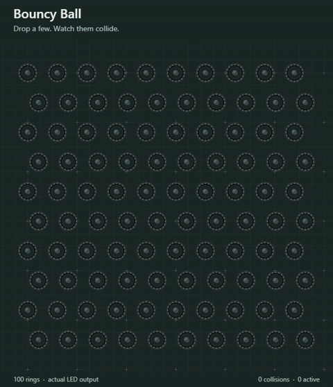

# SpringTable Studio

Brush across the virtual springs with a mouse or touch two springs at once on a touchscreen. For keyboard play, focus the table, move between springs with the arrow keys, and hold Enter or tap Space to pluck. [Open SpringTable Studio](https://biogoly.github.io/SpringTable/)

## Patterns

Choose a pattern by name in **Play → Pattern**. The mode numbers are for the Teensy's Serial Monitor. For example, `mode 9` selects Reflection.

| Mode | Pattern | What a pluck does |
| ---: | --- | --- |
| 0 | Ripple | Sends a colored pulse through nearby rings. |
| 1 | Spinner | Starts a comet circling the touched ring. It fades after release. |
| 2 | Solid | Fills the ring with color for as long as the spring is held, then fades. |
| 3 | Confetti | Scatters colored sparks around the touched ring. |
| 4 | Three-dot gear | Rotates three bright teeth around the ring. |
| 5 | Fire | Makes amber embers flicker around the ring. |
| 6 | Surface | Sends an expanding square outline across the table. |
| 7 | Ricochet | Launches a ball with a random color, speed, and direction. Its trail follows it around each rebound. |
| 8 | Drain | Pulls a trail into an accelerating inward spiral that ends in a white flash. |
| 9 | Reflection | Sends a ripple to the edges, where a paler echo races back to the spring. |
| 10 | Interference | Sends a train of ripples. Two crests reinforce each other, and equal crests and troughs cancel to black. |
| 11 | Reflected Interference | Reflects each wave at the edge. Returning ripples can reinforce or cancel waves still traveling outward. |
| 12 | Bouncy Ball | Drops a randomly colored ball from rest. Gravity accelerates the fall, and each rebound loses energy until the ball settles and fades. |

### Drop a bouncing ball

Choose **Bouncy Ball** and pluck a spring near the top of the layout, then try one near the bottom. Balls fall straight down to a flat floor at the lowest LEDs. A higher release means greater impact speed, a higher rebound, and a longer lifetime. Each ball has its own color and clock. Holding a spring launches once, and releasing and touching again adds another ball. Up to 128 balls can overlap.

The simulation uses 9.81 m/s² gravity and retains 78% of vertical speed at each impact, making each rebound about 61% as high as the last. Once the next bounce would rise less than 0.5 mm, the ball settles and fades over 400 ms. On sparse layouts, the nearest LEDs show its position across gaps. **Pause** and **+16 ms** let you inspect the motion. On the Teensy, use `mode 12`.

### Pluck a pair

Choose either interference pattern, select **Pick two springs**, and click two different rings. Both waves launch on the second click. In **Reflected Interference**, try one spring near the edge and one near the center to see how the first returning wave crosses the other. **Run demo** repeats a paired launch.

**Wave palette** controls the crest and trough colors. Choose a preset, edit either swatch, or select **Random per pluck pair**. Each new pair then draws fresh colors while earlier waves and their echoes keep theirs. **Keep these colors** turns the latest pair into a fixed palette. **Teensy command** shows the corresponding serial command. [See three palettes on the same frame](../Interference-palettes.png)

### Inspect a frame

Choose **Pause**, then **+16 ms** to advance one frame at a time. Select a ring and choose one of its 16 LEDs in **Pixel inspector** to see its output RGB. **Touch all** is a quick way to test the current budget. Compare **Requested**, **LED output**, and **Frame scale** as you change the budget. Studio estimates current from the pixel values and dims the whole frame when the requested load exceeds the budget.

## Layout and pattern design

In **Layout**, generate a rectangular grid, hexagonal lattice, circle, or spiral with up to 400 rings. Increase the spacing to give traveling waves more distance to cross. Drag a ring or enter its X and Y coordinates in millimeters. **Add ring** places a ring at the next click, **Undo layout** reverses an edit, and **Fit** brings the whole board back into view.

### Lay out a display board

1. Choose an arrangement and ring count. Under **Placement plan**, enter the measured **ring outer diameter** and the **board margin**. The margin is the clear border between the outermost ring edges and the sides of the board.
2. Set the **minimum edge gap** and click **Apply gap**. Studio scales the layout until the closest pair of ring edges has that clearance. On a spiral the distances between neighbors vary. The spacing slider controls the overall scale, and the plan reports the actual closest spacing.
3. Expand **Ring center coordinates**. Facing the front of the board, use the top-left corner as zero. Measure X to the right and Y down to mark each spring center. The board dimensions and centers update when rings move.
4. Download **Coordinates CSV** for the numbered measurements or **1:1 drawing SVG** for a full-size drawing with ring outlines and center marks. Both use millimeters and the same ring numbers. For a paper template, print the SVG at actual size and check a known dimension before marking the board.

For example, choose **Spiral**, enter **200** rings, set the outer diameter to **38 mm** and the margin to **10 mm**, then apply a **10 mm** minimum edge gap. The closest centers are 48 mm apart. The board measures approximately **1,400.065 × 1,386.198 mm**. Choose **Save project** to keep the geometry and mounting dimensions together. [Example project](../examples/200-ring-spiral/200-ring-spiral.json) · [Coordinate sheet](../examples/200-ring-spiral/200-ring-spiral.csv) · [Full-size drawing](../examples/200-ring-spiral/200-ring-spiral.svg)

### Create a pattern

In **Pattern lab**, choose **Create a pattern**. A **Touch wave** has controls for shape, color, speed, reach, trail, and held glow. For a moving red dot, choose **Pixel formulas** and enter one expression per channel.

| Red | Green | Blue |
| --- | --- | --- |
| `if(held, 255 * (p == floor(t * 12) % 16), 0)` | `0` | `0` |

Select **Apply & test pattern** and hold a spring. The dot moves 12 LED positions per second. Here `p` is the LED index (0–15) and `t` is time in seconds. Expand **Variables & functions** for the other inputs. Custom layouts and patterns run in Studio. Running them on a physical table requires a firmware port.

## Save a project or open an example

**Save project** downloads a JSON file containing the layout, custom patterns, selected effect, palette, and current budget. Use **Open** to load a saved file. Studio also tries to restore the last project in the same browser.

The repository includes 100-ring spiral projects. Download an example from GitHub using **Download raw file**, then choose it with **Open** in Studio.

- Drop a ball under gravity, bounce between the edges, or follow an inward spiral. [Bouncy Ball](../Bouncy%20Ball%20Spiral.json) · [Ricochet](../Ricochet%20Spiral.json) · [Drain](../Drain%20Spiral.json)
- Compare a returning echo, two interfering waves, and both effects together. [Reflection](../Reflection%20Spiral.json) · [Interference](../Interference%20Spiral.json) · [Reflected Interference](../Reflected%20Interference%20Spiral.json)
- Try fixed colors or draw a new pair on every launch. [Amber and Blue](../Amber%20and%20Blue%20Spiral.json) · [Random Palette](../Random%20Palette%20Spiral.json)

For offline use, download and extract the repository ZIP, then open `SpringTable Studio.html` in a browser. The example JSON files are in the same folder. [Download the repository ZIP](https://github.com/biogoly/SpringTable/archive/refs/heads/master.zip)
